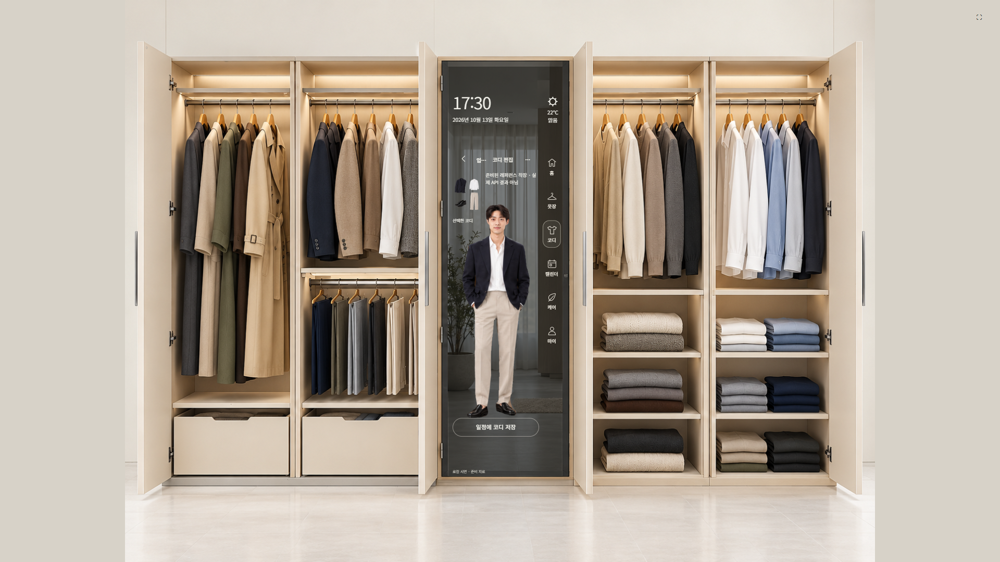
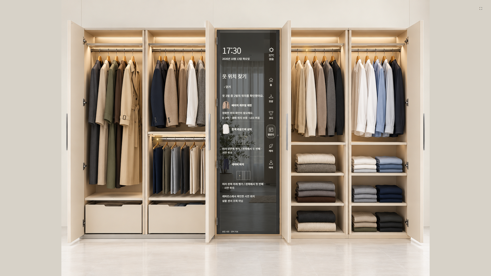

# 공개 배포와 실제 브라우저 검수

2026-10-13. 앱 소스 기준 `11717583e80466eb959863a9737b4cf1dc3f0d55`, SQL 바이트 보존 및 로컬 인계 체크포인트 `edff26e091605c76e087b319b8df486fe9f9c1d8`.

- 저장소: https://github.com/bryan528c/CLOS-IT
- 웹사이트: https://bryan528c.github.io/CLOS-IT/
- 실제 배포 코드: `14664c511d0b1bd836c974286ec29c6e28b5fcca`.
- [GitHub Actions 성공 기록](https://github.com/bryan528c/CLOS-IT/actions/runs/38302175373): 잠금 의존성 설치, 포함된 520개 검사 통과(1개 미실행), 빌드, Pages 게시 완료.
- 첫 CI 실행에서 검증된 SQL의 줄바꿈 변환으로 해시 검사가 실패했다. 원본 SQL·기록 해시·검사를 바꾸지 않고 Git의 해당 파일 바이트 보존 설정을 수정했다. DB 적용은 하지 않았다.

## 공개 주소에서 확인한 결과

PC 개발 서버와 API 서버(4311/4312)를 모두 종료한 상태에서 새 격리 Chrome 프로필을 사용했다. 초기 데이터나 성공 결과를 주입하지 않고 실제 UI로 조작했다. **주 검사 12/12, 별도 결혼식 흐름 3/3 통과**.

| 항목 | 결과 |
|---|---|
| 김수진·최휘재 | 팩 24품목씩, 중복 프로필 없음. 기존 생활 데이터 포함 전체 의류는 80개이며 48개로 초기화하지 않음 |
| 사진·케어 | 48품목 각각 검색→격자→상세 사진, 같은 의류의 가이드와 시연 라벨 48개 바이트 확인 |
| 코디 | 카드 11개 조회·북마크, 정확한 A/B 준비 전신, 상의만 교체하고 다른 품목 유지 |
| 새 조합 | 새 카드 저장, 10월23일 계획 저장, 원본 카드·과거 기록 보존 |
| 위치 | 수진 코트 1개. B는 재킷·상의·바지 3항목 중 검증된 2곳만 점등. 재킷 보류 유지 |
| 결혼식 | 코디 미선택 일정→B 선택→같은 제목·날짜 저장→프로필 왕복·새로고침 재조회 |
| 로컬 사진·저장 | 수동 사진 등록, 프로필 왕복·새로고침·Chrome 프로세스 재시작 후 사진 바이트와 카드·계획·초안 보존 |
| 레이아웃 | 1920×1080 및 2560×1440, 100%에서 달력 7열·격자·본문과 메뉴 분리 검사 |
| 요청 오류 | JS 오류 0, HTTP 누락 0, 외부/API 요청 시도 0, 원격 쓰기·유료 실행 0 |

공개 첫 검사 시도는 첫 로딩의 networkidle 15초 대기에서 중단되어 기능 검사는 0개였다. 초기 팩 파일 검증을 기다리도록 탐색 대기를 늘린 재실행이 위 결과다. 실패 시도를 성공으로 합산하지 않았다.

## 모드와 남은 범위

공개 사이트는 **브라우저 로컬 저장 시연**이다. `.env`·API 키·실제 사용자 저장값·개인 사진·이전 Git 이력은 공개하지 않았다. 다른 주소나 다른 브라우저로 기존 저장값이 자동 이전되지 않는다. 같은 사이트에서 재방문할 때 receipt를 사용하며 전체 데이터를 다시 초기화하지 않는다.

준비 전신 두 개는 `reference_saved/static_image`이며 실제 OpenAI/Decart 실행 결과가 아니다. 정확한 프로필·인물·전체 의류·자산 버전 조건이 다른 새 조합에 재사용하지 않는다. 준비 결과가 없는 조합도 카드와 계획을 저장할 수 있다.

기존 API·인증·DB 코드는 보존하지만 Pages에는 Node 서버가 없다. 실제 API 시도는 성공을 위장하지 않고 명시적 `503 backend_unavailable`로 처리한다. 실계정·원격 저장·유료 API는 이번에 실행하지 않았다.

B 재킷의 정확 위치, 핵심 저해상도와 가려진 소매·허리, 실제 상품/라벨·실물 장치 검증은 남아 있다. 현재 팩에 없는 세 번째 정확 LED를 만들어 검수하지 않았다. 저장 응답을 인위적으로 지연한 순간의 프로필 전환은 단위검사 경계까지이며 최종 공개 브라우저 별도 지연 시험은 미실행이다.

이 문서와 캡처를 추가한 후속 커밋은 앱 코드·자산·데이터 계약을 변경하지 않는다. 원본 작업공간의 비공개 증거에는 실제 브라우저 전체 녹화와 항목별 결과를 별도로 보존했다.
